# 基于Java的大学生迎新系统

> 🎓 **计算机毕业设计 · 基于Java的大学生迎新系统**
>
> 本仓库只放**项目介绍 + 运行截图**（截图是站点带水印的原图，存在仓库 `images/` 里）。
>
> 👉 **完整可运行源码 / 数据库脚本 / 部署文档：[点我获取](https://geekcode.top/archives/%E5%9F%BA%E4%BA%8EJava%E7%9A%84%E5%A4%A7%E5%AD%A6%E7%94%9F%E8%BF%8E%E6%96%B0%E7%B3%BB%E7%BB%9F?utm_source=github)**
>
> 💬 咨询微信：**ir9372**　|　🌐 更多项目：[极客代码 geekcode.top](https://geekcode.top/?utm_source=github)
>
> 📌 项目详情页：<https://geekcode.top/archives/%E5%9F%BA%E4%BA%8EJava%E7%9A%84%E5%A4%A7%E5%AD%A6%E7%94%9F%E8%BF%8E%E6%96%B0%E7%B3%BB%E7%BB%9F?utm_source=github>

<table><td width="230" align="center"> <b>扫码加微信 ir9372</b></td><td valign="middle">📦 源码 = 项目介绍 + 全部运行截图 + 数据库 + 部署文档 👉 点上方任意截图，直接跳到 <b>极客代码 geekcode.top</b> 详情页</td></table>

---

<h1>基于Java的大学生迎新系统</h1>
<h2>项目概述</h2>

本项目为基于Java的大学生迎新系统，旨在通过数字化手段优化高校新生入学流程。系统采用前后端分离架构，核心功能涵盖学校信息展示、专业介绍、宿舍分配查询、入学通知发布及报到预约管理。适用人群主要为高校新生（前台用户）与学校行政管理人员（后台管理员）。技术栈选用Spring Boot构建后端服务，MyBatis-Plus实现数据持久化，Apache Shiro负责权限控制，前端集成Vue框架。该系统解决了传统迎新工作中信息分散、线下排队效率低的问题，实现了新生从了解学校到完成报到的全流程线上化管理，提升了校园信息化服务水平。

<h2>技术架构</h2>
<h3>1. 总体架构设计</h3>

系统采用典型的三层架构模式：表现层、业务逻辑层和数据访问层。前端使用Vue.js构建单页面应用（SPA），通过HTTP请求与后端交互；后端基于Spring Boot框架，提供RESTful API接口；数据库采用MySQL存储结构化数据。

<a href="https://geekcode.top/archives/%E5%9F%BA%E4%BA%8EJava%E7%9A%84%E5%A4%A7%E5%AD%A6%E7%94%9F%E8%BF%8E%E6%96%B0%E7%B3%BB%E7%BB%9F?utm_source=github" title="查看完整源码">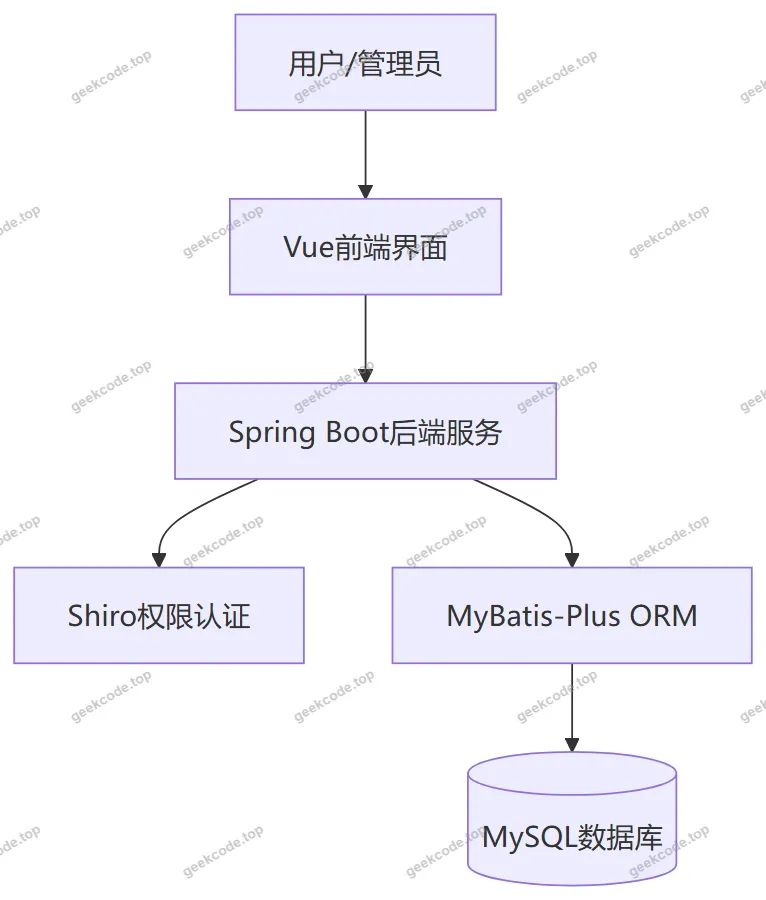</a>

<h3>2. 核心技术选型理由</h3>
<ul>
<li><strong>Spring Boot</strong>: 简化了Spring应用的初始搭建以及开发过程，内置Tomcat服务器，便于快速部署微服务或单体应用，适合毕业设计项目的快速迭代。</li>
<li><strong>MyBatis-Plus</strong>: 在MyBatis基础上增强，提供了通用的CRUD操作和分页插件，减少了大量重复的SQL编写工作，提高了数据访问层的开发效率。</li>
<li><strong>Apache Shiro</strong>: 轻量级安全框架，用于处理身份验证、授权、加密和会话管理。在本项目中主要用于区分管理员与普通用户的访问权限，保护后台管理接口不被未授权访问。</li>
<li><strong>MySQL</strong>: 关系型数据库管理系统，支持事务处理，数据结构清晰，适合存储学生信息、公告、预约记录等结构化数据。</li>
</ul>
<h3>3. 数据库设计要点</h3>

根据控制器列表推断，数据库主要包含以下实体表：

<ul>
<li><strong>基础信息表</strong>：<code>xuexiaoxinxi</code> (学校信息), <code>zhuanyejieshao</code> (专业介绍), <code>sushexinxi</code> (宿舍信息), <code>banjixinxi</code> (班级信息), <code>kechengxinxi</code> (课程信息)。</li>
<li><strong>业务流程表</strong>：<code>baodaoyuyue</code> (报到预约), <code>ruxuetongzhi</code> (入学通知), <code>gonggaolan</code> (公告栏)。</li>
<li><strong>用户与互动表</strong>：<code>xuesheng</code> (学生/用户表), <code>discussxuexiaoxinxi</code> (学校信息评论), <code>discusszhuanyejieshao</code> (专业介绍评论), <code>storeup</code> (收藏表), <code>config</code> (系统配置)。</li>
<li><strong>其他</strong>：<code>aboutus</code> (关于我们), <code>file</code> (文件资源表)。</li>
</ul>
<h2>功能模块</h2>
<h3>1. 前台用户端（新生视角）</h3>

前台主要面向即将入学的新生，提供信息查询与自助服务功能。

<ul>
<li><strong>首页</strong>：展示系统概览及最新重要通知入口。</li>
<li><strong>公告栏</strong>：查看学校发布的各类通知公告，如开学时间、注意事项等。</li>
<li><strong>学校信息</strong>：浏览学校基本概况，支持对信息进行评论互动。</li>
<li><strong>入学通知</strong>：接收并查看具体的个人入学通知书或批次通知。</li>
<li><strong>专业介绍</strong>：详细查看各专业的课程设置、培养目标等信息，支持评论。</li>
<li><strong>宿舍信息</strong>：查询分配的宿舍楼栋、房间号及相关设施信息。</li>
<li><strong>班级信息</strong>：查看所属班级的辅导员、班委及同学名单（推测自路由 <code>/banjixinxi</code> 及截图）。</li>
<li><strong>课程信息</strong>：预览入学初期的课程安排（推测自路由 <code>/kechengxinxi</code> 及截图）。</li>
<li><strong>报到预约</strong>：在线提交报到时间段预约申请，避免现场拥堵。</li>
<li><strong>个人中心</strong>：管理个人信息、查看我的预约记录、我的收藏列表及历史评论。</li>
</ul>
<h3>2. 后台管理端（管理员视角）</h3>

后台面向学校行政人员，负责数据维护与业务审核。

<ul>
<li><strong>登录页</strong>：管理员身份验证入口。</li>
<li><strong>学生管理</strong>：录入、编辑、删除学生基本信息，管理用户账号状态。</li>
<li><strong>报道预约管理</strong>：审核新生的报到预约申请，调整预约时段容量。</li>
<li><strong>学校信息管理</strong>：发布或更新学校简介、地理位置、联系方式等内容。</li>
<li><strong>专业介绍管理</strong>：维护各专业详细信息，确保招生宣传内容的准确性。</li>
<li><strong>宿舍信息管理</strong>：分配和管理宿舍资源，更新宿舍状态。</li>
<li><strong>班级信息管理</strong>：创建班级档案，关联学生与班级。</li>
<li><strong>课程信息管理</strong>：发布新生必修或选修课程大纲。</li>
<li><strong>入学通知管理</strong>：批量发送或指定发送入学通知给特定学生群体。</li>
<li><strong>公告栏管理</strong>：发布全校性公告，设置置顶或有效期。</li>
<li><strong>评论管理</strong>：审核学校信息与专业介绍下的用户评论，过滤不良信息。</li>
<li><strong>关于我们</strong>：维护系统介绍页面内容。</li>
<li><strong>系统配置</strong>：修改网站标题、Logo、版权信息等全局参数。</li>
</ul>
<h2>用户角色与权限</h2>

本系统主要涉及两种核心角色：<strong>普通用户（新生）</strong> 和 <strong>管理员</strong>。

<table>
<thead>
<tr>
<th align="left">角色</th>
<th align="left">权限描述</th>
<th align="left">可访问模块</th>
</tr>
</thead>
<tbody><tr>
<td align="left"><strong>普通用户</strong></td>
<td align="left">拥有只读或有限写入权限，主要进行信息浏览和个人业务办理。需注册登录后使用部分功能。</td>
<td align="left">1. <strong>信息浏览</strong>：首页、公告栏、学校信息、入学通知、专业介绍、宿舍信息、班级信息、课程信息。2. <strong>互动功能</strong>：对学校信息和专业介绍发表评论。3. <strong>业务办理</strong>：提交报到预约申请。4. <strong>个人管理</strong>：查看个人中心、管理自己的收藏列表、查看自己的预约记录。</td>
</tr>
<tr>
<td align="left"><strong>管理员</strong></td>
<td align="left">拥有最高权限，可进行数据的增删改查（CRUD）、业务审核及系统配置。通过Shiro鉴权进入后台。</td>
<td align="left">1. <strong>用户管理</strong>：学生信息的增删改查。2. <strong>内容管理</strong>：学校信息、专业介绍、宿舍信息、班级信息、课程信息、入学通知、公告栏、关于我们的发布与维护。3. <strong>业务审核</strong>：处理报到预约请求。4. <strong>社区管理</strong>：审核和管理所有评论（学校信息评论、专业介绍评论）。5. <strong>系统运维</strong>：配置文件修改、上传文件管理。</td>
</tr>
</tbody></table>

<em>注：根据现有代码结构，未明确提及教师或其他中间角色，故仅列出上述两类角色。</em>

<h2>项目特色与创新点</h2>
<ol>
<li>
<strong>全流程线上化闭环</strong>：
   系统不仅仅提供信息展示，还集成了“报到预约”这一关键业务环节。新生可在前台自主预约到校时间，管理员在后台实时查看和处理预约数据，有效缓解了传统迎新现场的人流压力，体现了“智慧校园”的服务理念。

</li>
<li>
<strong>多维度的信息聚合与互动</strong>：
   打破了传统迎新手册静态阅读的局限，将学校概况、专业详情、宿舍分配、课程预告等多源数据整合在一个平台。同时，引入评论机制（针对学校信息和专业介绍），允许新生之间、新生与学校之间进行初步的信息交流，增加了系统的活跃度和实用性。

</li>
<li>
<strong>标准化的权限与安全体系</strong>：
   采用 Apache Shiro 进行细粒度的权限控制，确保了后台管理接口的安全性。结合 MyBatis-Plus 的高效数据操作能力，保证了系统在多用户并发访问下的稳定性和响应速度。

</li>
<li>
<strong>模块化设计与易扩展性</strong>：
   基于 Spring Boot 的模块化 Controller 设计（如独立的 <code>BanjixinxiController</code>, <code>KechengxinxiController</code>），使得各个业务板块界限清晰。若未来需要增加“社团招新”或“失物招领”等新模块，只需新增对应的 Controller、Service 和 Mapper 即可，无需重构原有代码。

</li>
</ol>
<h2>部署环境</h2>

为确保系统正常运行，建议准备以下软硬件环境：

<ul>
<li><strong>操作系统</strong>：Windows 10/11, macOS, 或 Linux (CentOS/Ubuntu)</li>
<li><strong>JDK版本</strong>：JDK 1.8 或 JDK 11 (推荐 JDK 1.8，兼容性最佳)</li>
<li><strong>数据库</strong>：MySQL 5.7 或 MySQL 8.0</li>
<li><strong>构建工具</strong>：Maven 3.6+</li>
<li><strong>Node.js环境</strong>：Node.js 14.x 或 16.x (用于前端 Vue 项目的编译与运行)</li>
<li><strong>包管理器</strong>：npm 或 yarn</li>
<li><strong>Web服务器</strong>：Nginx (生产环境反向代理) 或 Tomcat (内嵌于 Spring Boot)</li>
<li><strong>开发工具</strong>：IntelliJ IDEA (后端), VS Code (前端)</li>
</ul>

<strong>启动步骤简述</strong>：

<ol>
<li>导入 SQL 脚本至 MySQL 数据库。</li>
<li>修改后端 <code>application.yml</code> 中的数据库连接配置。</li>
<li>使用 Maven 命令 <code>mvn clean package</code> 打包后端 jar 包，或直接运行主类启动后端服务。</li>
<li>进入前端目录，执行 <code>npm install</code> 安装依赖。</li>
<li>执行 <code>npm run serve</code> 启动前端开发服务器，或 <code>npm run build</code> 生成静态文件部署至 Nginx。</li>
</ol>
<h2>五、技术特性</h2>
<ul>
<li>前后端集成部署，前端资源打包至后端 static 目录</li>
<li>使用 MyBatis-Plus 简化数据访问层开发</li>
<li>集成 Shiro 权限框架实现角色权限控制</li>
</ul>
<h2>六、功能模块截图</h2>
<h3>前台用户端</h3>
<h4>前台-班级信息列表</h4>

<a href="https://geekcode.top/archives/%E5%9F%BA%E4%BA%8EJava%E7%9A%84%E5%A4%A7%E5%AD%A6%E7%94%9F%E8%BF%8E%E6%96%B0%E7%B3%BB%E7%BB%9F?utm_source=github" title="查看完整源码">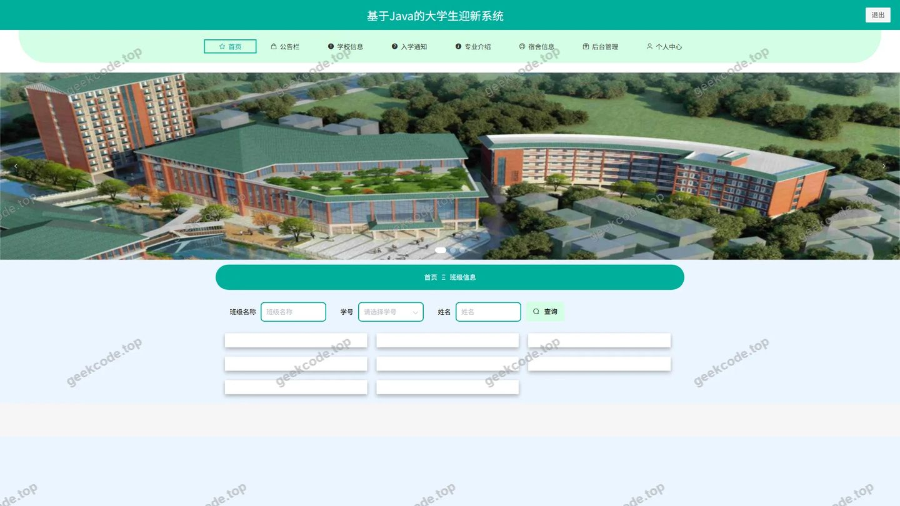</a>

<h4>前台-报道预约列表</h4>

<h4>前台-公告栏列表</h4>

<a href="https://geekcode.top/archives/%E5%9F%BA%E4%BA%8EJava%E7%9A%84%E5%A4%A7%E5%AD%A6%E7%94%9F%E8%BF%8E%E6%96%B0%E7%B3%BB%E7%BB%9F?utm_source=github" title="查看完整源码">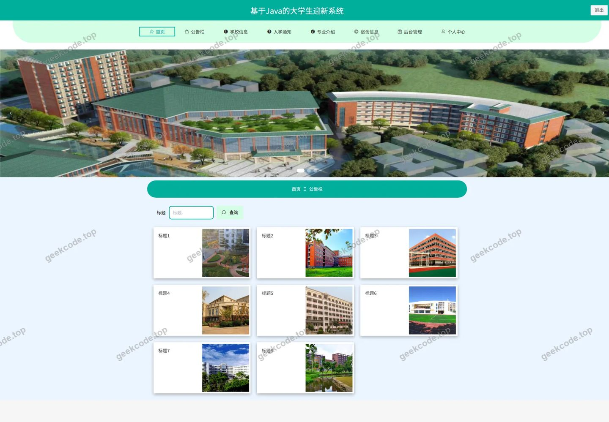</a>

<h4>前台-课程信息列表</h4>

<h4>前台-入学通知列表</h4>

<a href="https://geekcode.top/archives/%E5%9F%BA%E4%BA%8EJava%E7%9A%84%E5%A4%A7%E5%AD%A6%E7%94%9F%E8%BF%8E%E6%96%B0%E7%B3%BB%E7%BB%9F?utm_source=github" title="查看完整源码">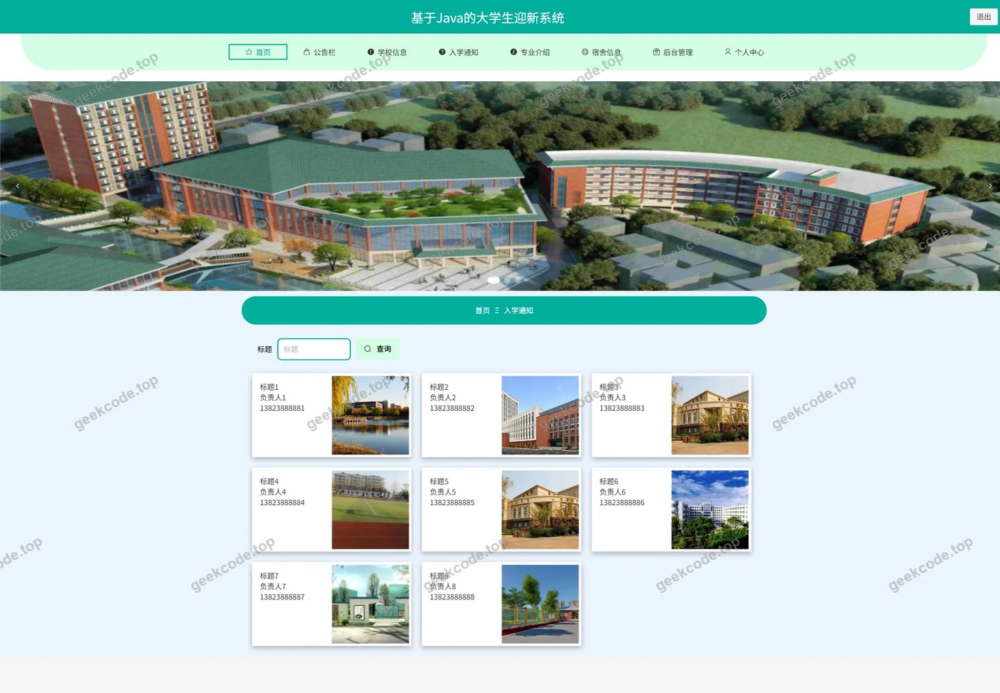</a>

<h4>前台-收藏列表</h4>

<a href="https://geekcode.top/archives/%E5%9F%BA%E4%BA%8EJava%E7%9A%84%E5%A4%A7%E5%AD%A6%E7%94%9F%E8%BF%8E%E6%96%B0%E7%B3%BB%E7%BB%9F?utm_source=github" title="查看完整源码">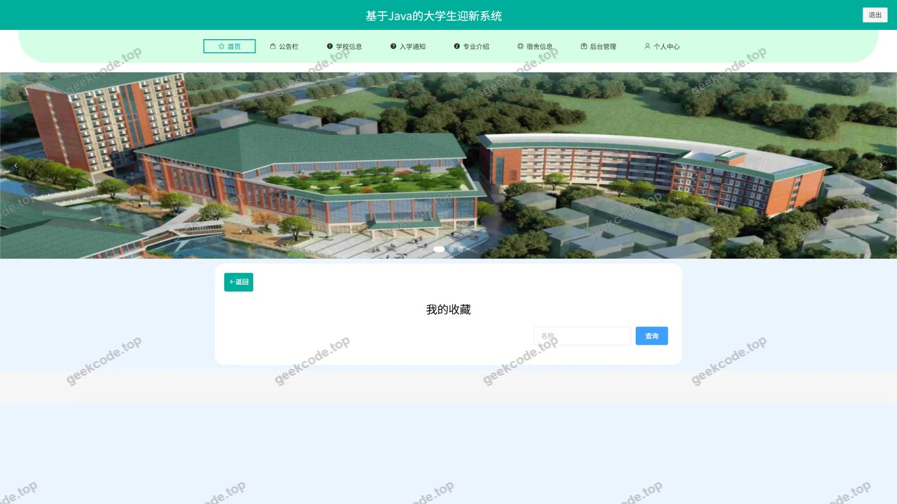</a>

<h4>前台-宿舍信息列表</h4>

<a href="https://geekcode.top/archives/%E5%9F%BA%E4%BA%8EJava%E7%9A%84%E5%A4%A7%E5%AD%A6%E7%94%9F%E8%BF%8E%E6%96%B0%E7%B3%BB%E7%BB%9F?utm_source=github" title="查看完整源码">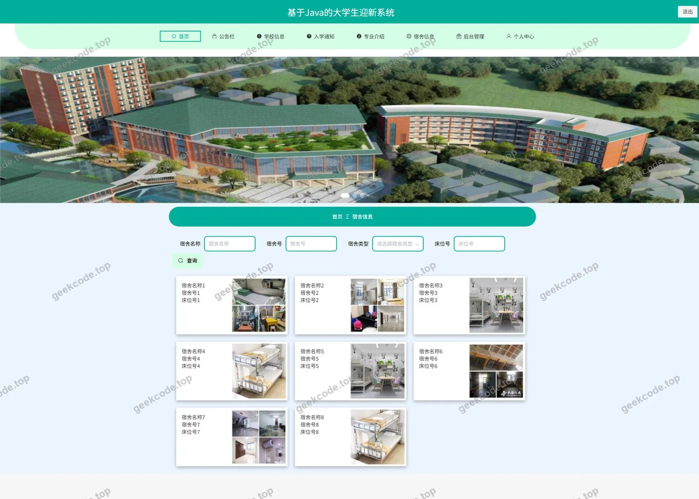</a>

<h4>前台-学校信息列表</h4>

<a href="https://geekcode.top/archives/%E5%9F%BA%E4%BA%8EJava%E7%9A%84%E5%A4%A7%E5%AD%A6%E7%94%9F%E8%BF%8E%E6%96%B0%E7%B3%BB%E7%BB%9F?utm_source=github" title="查看完整源码">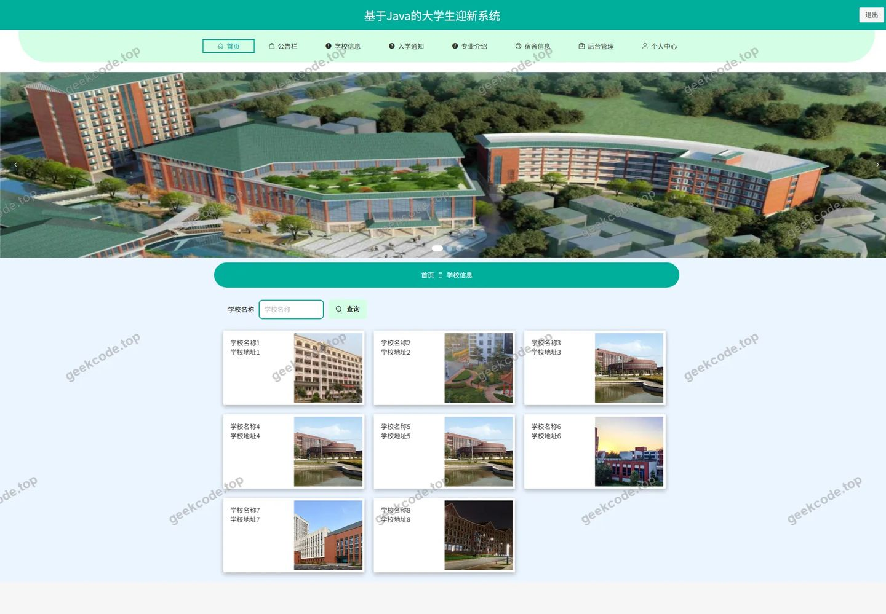</a>

<h4>前台-专业介绍列表</h4>

<a href="https://geekcode.top/archives/%E5%9F%BA%E4%BA%8EJava%E7%9A%84%E5%A4%A7%E5%AD%A6%E7%94%9F%E8%BF%8E%E6%96%B0%E7%B3%BB%E7%BB%9F?utm_source=github" title="查看完整源码">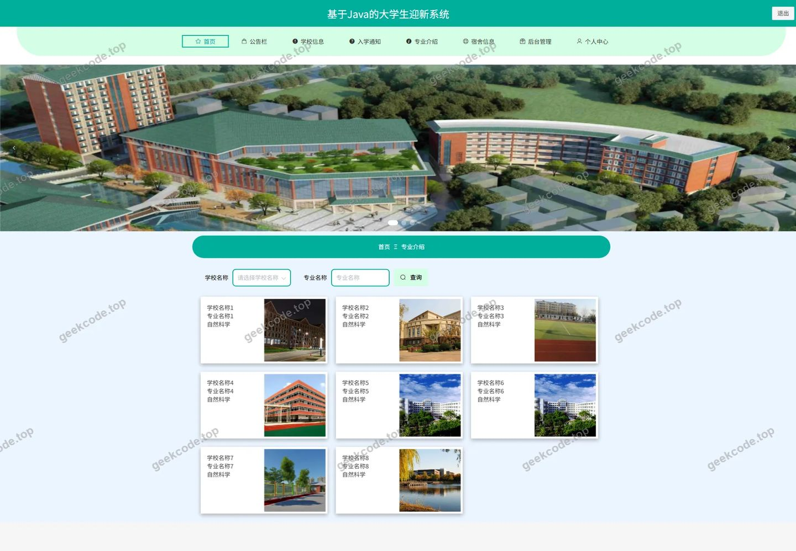</a>

<h4>前台-个人中心</h4>

<a href="https://geekcode.top/archives/%E5%9F%BA%E4%BA%8EJava%E7%9A%84%E5%A4%A7%E5%AD%A6%E7%94%9F%E8%BF%8E%E6%96%B0%E7%B3%BB%E7%BB%9F?utm_source=github" title="查看完整源码">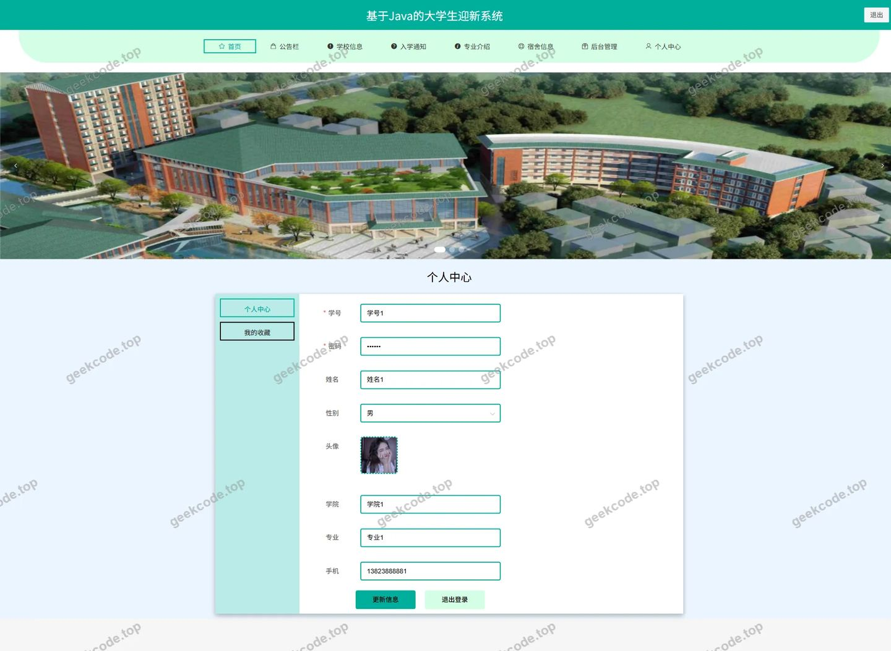</a>

<h3>后台管理端</h3>
<h4>后台-报道预约</h4>

<a href="https://geekcode.top/archives/%E5%9F%BA%E4%BA%8EJava%E7%9A%84%E5%A4%A7%E5%AD%A6%E7%94%9F%E8%BF%8E%E6%96%B0%E7%B3%BB%E7%BB%9F?utm_source=github" title="查看完整源码">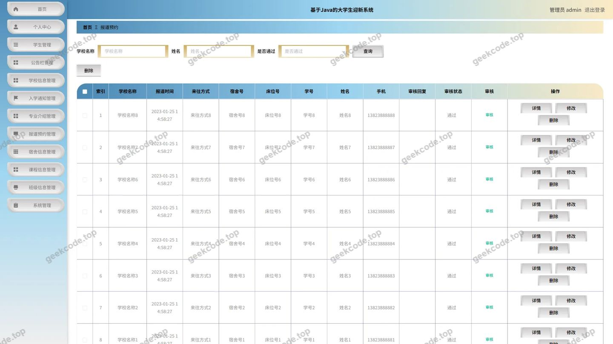</a>

<h4>后台-登录页</h4>

<a href="https://geekcode.top/archives/%E5%9F%BA%E4%BA%8EJava%E7%9A%84%E5%A4%A7%E5%AD%A6%E7%94%9F%E8%BF%8E%E6%96%B0%E7%B3%BB%E7%BB%9F?utm_source=github" title="查看完整源码">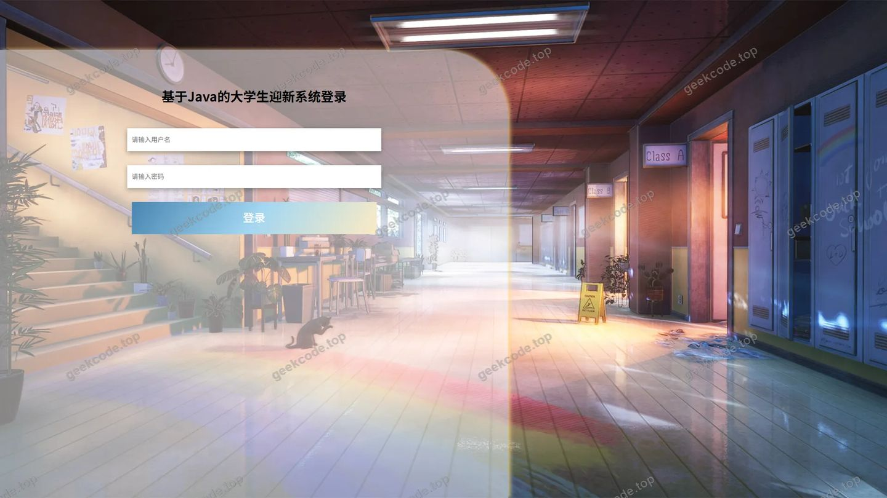</a>

<h4>后台-关于我们</h4>

<a href="https://geekcode.top/archives/%E5%9F%BA%E4%BA%8EJava%E7%9A%84%E5%A4%A7%E5%AD%A6%E7%94%9F%E8%BF%8E%E6%96%B0%E7%B3%BB%E7%BB%9F?utm_source=github" title="查看完整源码">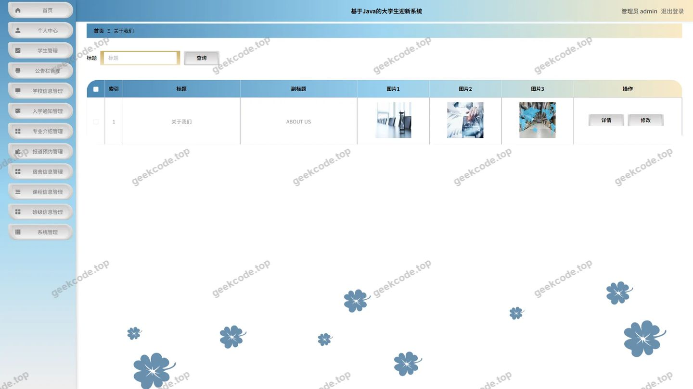</a>

<h4>后台首页</h4>

<a href="https://geekcode.top/archives/%E5%9F%BA%E4%BA%8EJava%E7%9A%84%E5%A4%A7%E5%AD%A6%E7%94%9F%E8%BF%8E%E6%96%B0%E7%B3%BB%E7%BB%9F?utm_source=github" title="查看完整源码">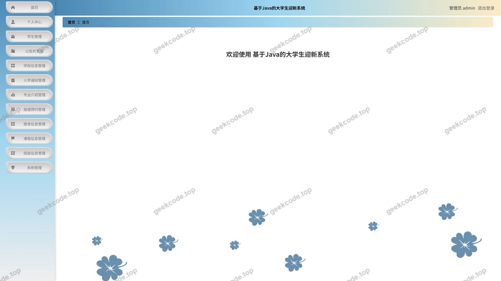</a>

<h4>后台-学生</h4>

<a href="https://geekcode.top/archives/%E5%9F%BA%E4%BA%8EJava%E7%9A%84%E5%A4%A7%E5%AD%A6%E7%94%9F%E8%BF%8E%E6%96%B0%E7%B3%BB%E7%BB%9F?utm_source=github" title="查看完整源码">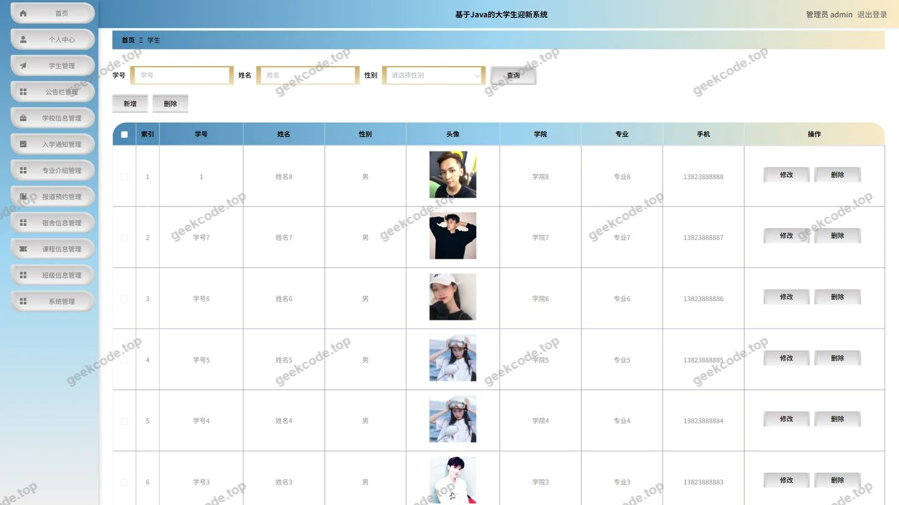</a>

<h4>后台-学校信息</h4>

<a href="https://geekcode.top/archives/%E5%9F%BA%E4%BA%8EJava%E7%9A%84%E5%A4%A7%E5%AD%A6%E7%94%9F%E8%BF%8E%E6%96%B0%E7%B3%BB%E7%BB%9F?utm_source=github" title="查看完整源码">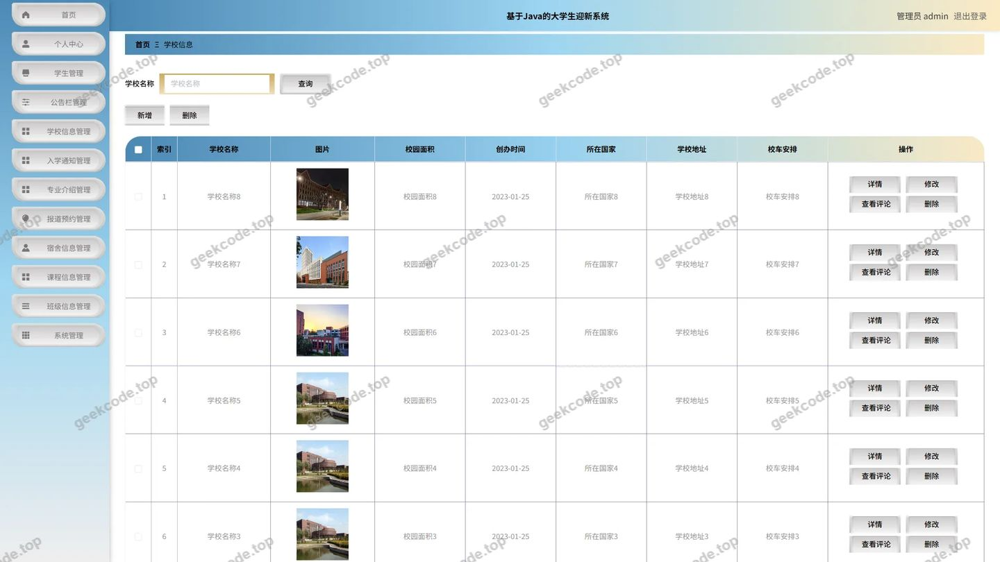</a>

<h4>后台-学校信息评论</h4>

<a href="https://geekcode.top/archives/%E5%9F%BA%E4%BA%8EJava%E7%9A%84%E5%A4%A7%E5%AD%A6%E7%94%9F%E8%BF%8E%E6%96%B0%E7%B3%BB%E7%BB%9F?utm_source=github" title="查看完整源码">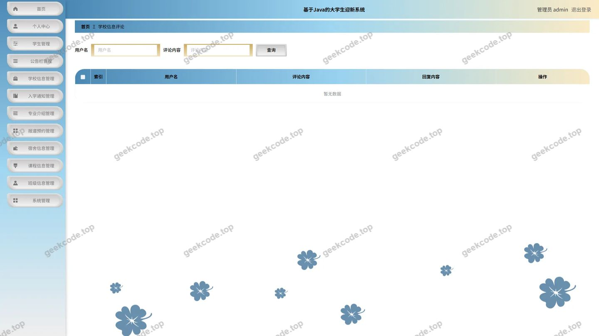</a>

<h4>后台-专业介绍</h4>

<a href="https://geekcode.top/archives/%E5%9F%BA%E4%BA%8EJava%E7%9A%84%E5%A4%A7%E5%AD%A6%E7%94%9F%E8%BF%8E%E6%96%B0%E7%B3%BB%E7%BB%9F?utm_source=github" title="查看完整源码">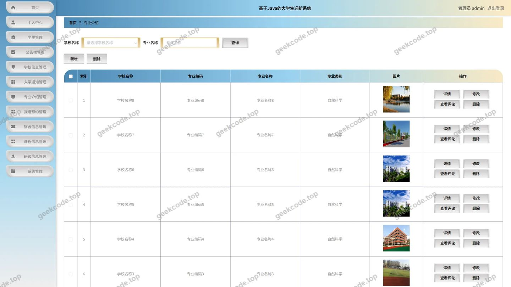</a>

---

## 获取完整源码

| 项目 | 说明 |
| --- | --- |
| 项目名 | 基于Java的大学生迎新系统 |
| 运行截图 | 本文 19 张（站点带水印原图，仓库 `images/` 目录） |
| 完整源码 | [https://geekcode.top/archives/%E5%9F%BA%E4%BA%8EJava%E7%9A%84%E5%A4%A7%E5%AD%A6%E7%94%9F%E8%BF%8E%E6%96%B0%E7%B3%BB%E7%BB%9F?utm_source=github](https://geekcode.top/archives/%E5%9F%BA%E4%BA%8EJava%E7%9A%84%E5%A4%A7%E5%AD%A6%E7%94%9F%E8%BF%8E%E6%96%B0%E7%B3%BB%E7%BB%9F?utm_source=github) |
| 咨询微信 | **ir9372**（备注：jingpin-yuanma） |
| 更多项目 | [极客代码 geekcode.top](https://geekcode.top/?utm_source=github) |

> 需要源码、部署、改配置、跑不起来等问题，加微信 ir9372 沟通，说明项目名即可。
